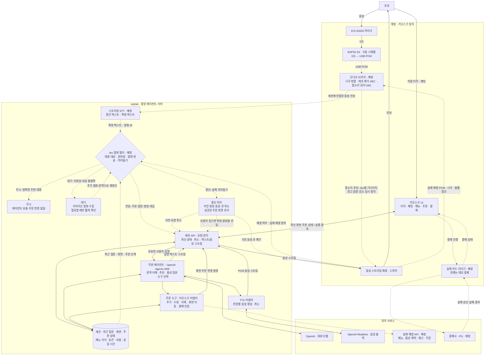

# SWitch 음성 주문 시스템 아키텍처

2026-11-22 갱신: 별도 [ESP32 입력 필터 CLI](음성입력_필터_시제품.md)에 수음·STT·VAD·발화 합치기·의미 판단을 구현했다. 아래 다이어그램은 중앙 에이전트에 통합할 목표 구조다. CLI의 `전달` 이벤트는 아직 중앙 API·주문 도구를 호출하지 않으며 AEC와 Jev 실서비스 평가도 미완료다.

2026-11-21 기준 설계. 현재 중앙 에이전트와 키오스크에 향후 음성 입력 장치를 연결하는 목표 구조다. `예정`은 미구현 연결을 뜻한다. 마이크의 USB PCM 수신은 시제품이 있으나 STT·대화 처리와 통합하지 않았다.

## 배치와 책임

| 구역 | 책임 | 현재 상태 |
| --- | --- | --- |
| ESP32-S3 + ICS-43434 | I2S 음성을 받아 USB로 PCM 전달 | 수음·PC 모니터링 시제품 |
| 매장 PC 오디오 브리지 | 누락·시각 정렬, 리샘플링, AEC, VAD, 음성 전송 | 대화용 통합 예정 |
| 키오스크 UI | 터치와 대화를 같은 주문에 반영, 화면 이동, 텍스트·음성 표시, 결제 흐름 | 구현, 결제는 데모 |
| 중앙 세션 API | 세션 소유권, 요청 식별, 스트림, 취소, 최신 UI 문맥 전달 | 텍스트 경로 구현, 음성 수신 경로 예정 |
| STT 연결 | 음성을 텍스트로 변환하고 중간·확정 발화 구분 | 예정, 엔진은 후속 선정 |
| Jev 발화 필터 | STT와 문맥을 읽어 전달·무시·대기·중단으로 분기 | 목표 구조에 명시, 호출·평가·통합은 예정 |
| 주문 에이전트 | 짧은 점원 응대, 추천, 선택 기억, 필요한 질문, 도구 선택 | 구현 |
| 도구·매장 데이터 | 옵션 검증, 장바구니 변경, 화면 명령, 판매 가능 여부 조회 | 데모 어댑터 구현, 실매장 API 연결 예정 |
| 음성 출력 | 문장별 TTS 생성, PCM 스트리밍, 중단 시 재생 큐 취소 | 구현 |
| 실제 결제 장치·PG | 승인·실패·취소의 실제 결과 제공 | 예정 |

현재 브라우저는 같은 출처의 `/agent-api`를 통해 중앙 서버에 연결한다. API 키와 모델·음성 설정은 서버에서 관리한다. 앞으로 추가할 오디오 수신도 이 중앙 서버에 세션을 연결하되, 바이너리 스트리밍 전송 방식과 장치 인증 계약은 후속 구현에서 확정한다. ESP32가 직접 모델을 실행하거나 결제를 승인하지 않는다.

## 음성 대화 흐름

1. 대화 세션이 활성화된 동안 계속 수음한다. 별도 호출어는 요구하지 않는다. 홈 복귀·주문 중단·완료로 세션을 끝내면 해당 세션의 수음·전송도 끝낸다. 원음 영구 저장은 기본 동작에 넣지 않는다.
2. PC가 스피커에서 실제 재생한 소리를 참조해 에코를 줄인다. 마이크 시제품은 USB 오디오 장치가 아닌 USB 시리얼 PCM이므로 브라우저 마이크의 에코 제거 옵션만으로 처리할 수 없다.
3. STT 중간 결과는 표시·미리 검색에 활용한다. 주문 변경은 수락한 확정 발화로 실행한다. `utterance_id`와 수정 번호로 STT 정정·중복 전달을 구분한다.
4. STT 다음의 Jev 발화 필터가 짧은 문맥과 발화로 대화 대상·관련성·완료 여부·끼어들기를 판단한다. 전달할 발화만 주문 에이전트로 보내고 주변 대화는 걸러낸다. 짧은 ‘네’도 앞 질문에 대한 답이면 통과시킨다. Jev는 음성 인식기나 VAD가 아니며 단독으로 모든 주변 대화를 구분한다고 가정하지 않는다.
5. 에이전트가 최신 화면·장바구니·최근 직접 조작을 읽고 도구를 호출한다. 도구 실행 결과를 화면에 반영하고 텍스트와 음성으로 짧게 알려 준다.

## Jev 발화 필터의 입력과 분기

Jev 필터를 STT와 주문 에이전트 사이의 별도 계층으로 둔다. 그림의 Jev는 판단 모델 호출과 결과를 행동으로 바꾸는 라우터를 합친 논리 블록이다. TypeSafe 서비스 호출은 중앙 서버 어댑터에서 수행하도록 설계하며 키오스크나 ESP32에 키를 배포하지 않는다. 이는 목표 설계이며 현재 Jev 호출은 구현하지 않았다.

입력은 STT 텍스트·확정 여부·발화 ID와 수정 번호, 직전 질문과 기대 답변, 최근 짧은 대화, 최신 화면·장바구니·주문 단계, TTS 재생 여부와 실제 들려준 범위다. 전체 메뉴와 전체 대화를 매번 보내지 않는다. 직접 터치한 변경도 최신 문맥에 반영한다.

| 분기 | 예시와 조건 | 동작 |
| --- | --- | --- |
| 전달 | 주문·메뉴 질문·수정, 직전 질문 뒤의 ‘네’ | 확정 발화를 세션 API로 보내 에이전트 실행 |
| 무시 | 동행자에게 한 말이라는 근거가 명확함 | 에이전트와 주문 도구를 호출하지 않고 대기 |
| 대기 | 이어 말하는 중이거나 대화 대상이 불명확함 | 다음 발화를 합쳐 재판단, 필요한 경우에만 한 가지 확인 |
| 중단 | ‘잠깐만’, ‘아니 따뜻한 걸로’처럼 현재 안내를 끊는 의도 | 이전 생성·음성 큐 취소, 후속 요청이 있으면 에이전트에 전달 |

‘엄마는 뭐 마실래?’도 문자열만으로 무조건 버리지 않는다. 실제 대화 대상과 문맥을 함께 본다. 웃음·잡음은 먼저 오디오 전처리에서 줄이며, Jev에는 STT와 제공된 음향 신호로 판단할 수 있는 범위만 맡긴다.

위 분기는 우리 시스템의 내부 동작 계약이며 Jev의 기본 제공 API 필드라고 가정하지 않는다. 판단 결과와 확률·신뢰도는 어댑터에서 매핑하고 한국어 실제 사례로 기준을 조정한다. 필터 장애를 ‘무관한 말’로 처리해 조용히 버리지 않는다. 장애 시 대체 문맥 판단 또는 입력 보류·화면 안내 정책을 두며, 결제 중복 실행 방지는 기존 상태·요청 ID 검증이 담당한다.

명확한 응답을 문맥 규칙으로 빠르게 통과시키는 최적화는 비교 평가 후 적용한다. Jev 필터를 생략하는 별도 제품 흐름이 아니라 같은 계층 안의 실행 방식이다. Jev 호출 단위는 의미 있는 발화이며 모든 PCM 프레임이나 STT 토큰을 호출 단위로 쓰지 않는다.

무시한 발화로 안내를 잠깐 멈췄다면 재생을 이어갈 수 있고, 대기 중이면 잠정 정지를 유지한다. 중단만 요청했다면 새 주문 답변을 강제로 만들지 않는다. 어떤 분기도 결제 승인 권한이나 반복 확인 조건을 추가하지 않는다.

## 끼어들기와 상태 일치

로컬 VAD가 손님 말소리 후보를 감지하면 클라우드 판단을 기다리지 않고 먼저 음량을 줄이거나 재생을 멈추는 구조로 설계한다. STT와 문맥 판단이 실제 끼어들기로 확인하면 이전 응답 생성과 대기 중 음성 큐를 취소하고 새 발화를 처리한다. 무관한 소리라면 안내를 재개할 수 있도록 재생 위치를 관리한다. 이 자동 감지·재개는 예정이며, 현재는 채팅 입력과 ‘말 끊기’로 중단한다.

중단할 때 이미 성공한 메뉴 추가·수정 결과는 유지한다. 이전 요청의 늦은 답변·음성·화면 명령은 요청 ID와 세대 번호로 차단한다. 결제 도중에는 실제 장치 결과를 다시 읽어 같은 결제를 중복 실행하지 않는다.

화면 직접 조작도 새 상태와 이벤트로 서버에 전달한다. 손님이 말없이 메뉴를 삭제하거나 포장으로 바꾸면 다음 답변부터 그 결과를 사용한다. 이를 모델의 재학습으로 취급하지 않고 해당 세션의 실시간 문맥 갱신으로 처리한다. 다중 장치·실매장 연결에서는 서버의 주문 버전과 실행 ID를 기준으로 충돌·중복을 조정하도록 확장한다.

## 주문 마무리와 결제

‘다 골랐어’, ‘결제할래’는 주문 확인 화면으로 이어진다. 이미 확인 중이면 ‘그래’, ‘맞아’ 같은 자연스러운 동의로 결제수단 화면에 진행한다. 낭독 완료·전달 ACK·정확한 동의 단어를 반복해서 요구하지 않는다. 매장·포장만 바꾼 경우 변경을 반영하고 이어 간다.

에이전트는 결제수단 선택과 리더기 화면까지 연결한다. 청구 승인·실패·완료는 실제 리더기와 결제사의 결과를 따른다. 현재 데모는 기존 결제 시뮬레이션 결과를 사용하며 실제 결제망 연결을 의미하지 않는다.

## 후속 구현 경계

- 오디오 브리지와 장치 인증·세션 연결, 네트워크 재연결 시 중복 방지.
- 스트리밍 STT 엔진 선정과 부분 발화 정정, 끝맺음·추가 발화 처리.
- 실제 재생 PCM 기준 AEC와 로컬 중단·재개, 발화 판단기 비교 실험.
- 실매장 메뉴·재고·품절·옵션 제약·주문 API와 주문 버전 계약.
- 실제 결제 장치·PG와 승인 상태 조회·취소·재시도 계약.

상세 연결 계획은 [음성 입력과 Jev 연결 계획](음성입력과_Jev_연결_계획.md)을 참고한다. 과거 문서의 요약 낭독·전달 확인 조건보다 [반복 확인을 줄이는 정책](확인_반복을_줄이는_정책.md)을 우선한다.
